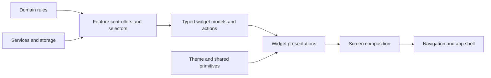

# UI architecture: reusable widgets, independent themes

**Status:** implemented in the native app, unreleased. Home, Feed, Circle and You use the same widget contracts as the interactive design. The roadmap inventory below is prospective; see [release notes](RELEASE_NOTES.md) for build status.

**Goal:** define a widget by what someone can learn or do with it. Its identity survives a redesign, so the team can choose or change the theme later.

Read this before adding a screen, extracting a component, implementing a roadmap feature, or applying a new design. [DESIGN.md](DESIGN.md) owns visual direction; this document owns component boundaries and composition. [GUIDANCE.md](GUIDANCE.md) owns advice content; [CYCLE_SYNC.md](CYCLE_SYNC.md) and [SCHEMA.md](SCHEMA.md) own cycle and sharing behavior. Keep roadmap priorities in [FEATURES.md](FEATURES.md), rather than duplicating their checkboxes here.

## Four layers of a screen

| Layer | What it owns |
|---|---|
| **Data and behavior** | Cycle calculations, permissions, loading and saving records, and the rules for features such as logging and rewards. |
| **Widgets** | A capability with named inputs, states and actions. Examples include Cycle Status, check-in, daily quest, upcoming phase and circle activity. The widget inventory below records which exist and which are planned. |
| **Screen composition** | Which widgets appear on Home, You or a future Insights screen, their order and prominence, and how much space each gets. |
| **Theme and presentation** | Shared tokens and components for colors, typography, spacing, surfaces, icons and illustrations. Each widget’s presentation determines how it displays its model at the chosen size. |

**Cycle Status** answers “Where am I in my cycle?” Its model supplies the current phase and day, the next transition when known, and the information needed to qualify an estimate. Its action opens cycle details. Home shows a compact strip with a separate “Coming up” card. You shows the full wheel, and a future Insights screen could show a detailed timeline, all using the same cycle facts and action.

For each screen, identify its widgets and their actions first, then choose a compact, full or detailed presentation where appropriate. Each presentation handles loading, empty and error states consistently. Change shared tokens to restyle a wheel across screens. To turn that wheel into a timeline, swap the presentation and keep its model and actions. The original [HTML mock](../design-mocks/home/index.html) explores one visual treatment. The six engineering responsibilities below explain how to implement these four layers.

## Implemented screen boundaries

Home now composes actual React Native widgets through these files:

| Layer | Implemented entry point | Ownership |
|---|---|---|
| Domain | `packages/domain/cycles/models.ts` → `deriveCycleTimeline` | Reuses the estimator’s five phase windows; anchors the day to the first day of the latest flow run, including calendar-day/DST handling |
| Cycle display model | `app/features/cycle/models/cycleOverview.ts` | Phase/day/ranges, observed versus estimated source, sync-date qualifier, stale/empty/loading/error states, upcoming transition and local guidance preview |
| Cycle presentations | `app/features/cycle/components/` | `CycleStatus` (hero/compact), `CycleTimeline`, `PhaseGuidancePreview`, `UpcomingTransition`; typed props and named callbacks, no storage/network/session imports |
| Feed adapter and controller | `app/features/feed/services/loadActivityFeed.ts`, `hooks/useActivityFeed.ts`, `models/activity.ts` | Projects permitted service rows to display models; merges posts/events; owns draft, reactions, queued boops, mutation locks, partial failures and late-response guards |
| Social presentations | `app/features/feed/components/` | `PostComposer`, `ActivityItem`, `ReactionBar`, `BoopAction`, `ReactionPicker`; selection/disclosure is local, commands go back to the controller |
| Theme | `app/theme/widgetTheme.tsx`, `app/components/ui/WidgetPrimitives.tsx`, `app/components/brand/WidgetArt.tsx` | Semantic surface/text/phase roles, typography/radius, optional decorative art; alternate neutral skin demonstrates the same contracts |
| Composition | Home, CircleFeedScreen, NativeCircleScreen, AddFriendsScreen, ProfileScreen and MemberProfileScreen | Screens choose widgets and handle links. SocialProvider owns one feed, one notification inbox and one friendship graph per signed-in account |

Home composition: identity and bell → compact cycle → guide tip → upcoming estimate → top sync match → latest update. Feed owns the composer and activity stream. See the page directory for every destination.

`CycleStatus` uses the snapshot’s sync date, labels its source, and keeps stale values visibly stale. An observed phase that differs from the estimated day-position marker gets an explicit explanation. Unknown history has no invented day or wheel. The new wheel consumes canonical ranges; the legacy friend comparison rings still have separate geometry. Shared PMS indicator labels/colors are corrected, but that does not migrate the legacy rings.

The account-scoped feed controller coalesces loads, rejects obsolete results and locks each target during a mutation. Reactions use saved choices/counts; boops restore queued status. Posts have no offline queue; failed drafts are kept. Deleting a post requires confirmation and a successful author-scoped deletion before rankings refresh.

**Reuse rule:** pass the same controller output to each widget placement. The signed-in social provider owns notifications, friend requests, Circle and the activity feed. You and Home read the cycle snapshot through a per-screen SQLite subscriber; cards do not run Health sync or generate advice. Drafts survive tab and theme switches within the session.

**Preview and verification:** [`design-mocks/home-widgets/README.md`](../design-mocks/home-widgets/README.md) runs the actual presenters with labeled fixtures, compact/full cycle placements, neutral/illustrated themes and state/width switches. Its sample data and actions never call production services. The older `design-mocks/home/` remains the original HTML concept. Automated tests cover selector semantics, typed-target mutation routing, stale reads, partial loads, queue restoration and failed drafts; TypeScript and iOS JS bundle checks pass. Browser checks cover 320/390px layouts, theme/draft continuity, empty/stale states and reaction controls. Physical iOS VoiceOver, Dynamic Type, keyboard interaction and authenticated service smoke checks remain required before release.

## Page directory

The native app and interactive design have four bottom tabs. An outward profile is the view of one member that another member can visit. You is the private workspace of the signed-in person.

| Page or flow | Placement in the design | Entry and contents |
| --- | --- | --- |
| Opening and sign-in | Launch and signed-out entry | Shared drop artwork, wordmark and two-line tagline. Preview enters Home and native sign-in uses the existing authentication flow |
| Home | Bottom tab | Selected previews that open a complete widget on Feed, Circle or You |
| Feed | Bottom tab | Updates, publishing and responses to updates |
| Circle | Bottom tab | Personal rankings, searchable friend directory and opt-in community rankings |
| Add friends | Secondary page, only from the Add Friends button beside Friends | Friend requests, Discover friends and Grow your circle |
| Settings | Secondary page from You | Personal info contains email and phone with individual change actions. The shared phone editor has separate boxes for the calling code (default +1) and national number. Privacy and permissions contains Post settings, Community rankings visibility and cycle data erasure/reconnection. Sign out and Delete account follow. |
| You | Bottom tab | Private identity editing, cycle, monthly recap, full Phase Guide, My posts and settings |
| Notifications | Secondary page, opened by the bell | One chronological list (oldest first) of activity and incoming requests with inline Accept/Decline. Identified senders open profiles |
| Member profile | Secondary page, one route parameterized by member ID | Open any person from a ranking, directory, request, search result, feed author or notification. Tap your name on You to open your own outward profile. Show identity and bio, relationship actions, eligible pair sync and shared updates visible to this viewer |
| Write a post | Secondary page from Share an update in Feed | Session-scoped draft and mood. Back resumes later, successful submit returns to Feed |
| Delete confirmation | Feed author action | Confirm removal of your own update |
| Edit profile / settings | You flows | Identity and posting preferences in the preview. Native settings also includes account actions and contact details |
| Sign-in / profile and contact setup / introduction and permissions | Native onboarding | Verified contacts and alias → initial ranking and posting choices → optional Apple Health → Home |

The wheel and full Phase Guide are sections of You. The countdown on Home opens the wheel. Add friends owns discovery and invitations. Received and Sent tabs share a request card. Sent requests support cancellation. Incoming requests also appear directly in Notifications. The member profile renders the full pair comparison inline for accepted friends. Its parent owns navigation and scrolling.

## Preliminary widget assignments

Each product widget has one primary page. Home reads a small selection from those widgets and links to the corresponding section or person. The [preview](../design-mocks/home-widgets/README.md) demonstrates these assignments with sample data.

| Primary page | Widget and full experience | Home preview or other entry |
| --- | --- | --- |
| You | **Your cycle** · phase, current day, source, freshness and full wheel. Hover or press the wheel to see all phase day ranges from the cycle model | Compact phase strip → wheel in You |
| You | **Coming up** · Home preview of the next estimated phase | Home countdown → full cycle wheel on You |
| You | **Phase Guide** · full suggestions for this phase, everyday fallback and personalized tips when available | One tip, such as “Try something new” → full guide inline |
| You | **Monthly recap** · cycle metrics and tracking coverage | You |
| You | **My posts** · the signed-in member's own posts, newest first | Last section of You; filters the same items and actions as Feed |
| You | **Profile identity, bio and avatar editor** · private editing and read-only outward identity | Greeting uses the name. The name on You opens the outward profile; the pencil edits it. Native supports avatar editing |
| You | **Health connection and sync status** · last sync, readable data, recoverable error | Cycle strip shows state and freshness |
| You | **Account and sharing settings** · automatic phase-post preferences, account actions, verified contact details and Community rankings opt-in | You settings. Contact details moved here on main in [PR #92](https://github.com/kratijain2631/period-app/pull/92) |
| Feed | **Activity stream and individual updates** · social posts and published cycle events with author and time | Latest update → Feed. Author → member profile |
| Feed | **Activity comments** · one expanded thread per list, keyed by parent type and ID. Reply to written and automatic updates or delete your own via the inline trash action | Shared updates on Feed and member profiles, written posts in My posts |
| Feed | **Post composer and author actions** · audience, mood, draft, submit and delete | Compose or resume in Feed |
| Feed | **Reaction bar, emoji picker and update boops** · counts, choices and delivery state | Activity item, including shared updates on a profile |
| Feed | **Notification inbox** · unread indicator, activity and links to subjects | Header bell → secondary Notifications page. Friend requests themselves belong to Circle |
| Circle | **Most in sync** · top five eligible friends, each shown in the same numbered row format. Friends without scores still appear in the directory | Home top match → Most in sync tab in Circle rankings; each leaderboard row → that person's outward profile |
| Circle | **Friend directory and identity row** · name, alias, search and available score; more than four matching friends scroll inside the list, with search above it | People shortcut → Circle. Each user row → outward profile |
| Circle | **Outward profile and pair sync** · shared identity, relationship, available score and shared updates. Accepted friends see trends, comparisons, suggestions, friend-directed boops and confirmed removal directly on this profile | Same member ID from every entry. The viewer's private cycle and settings stay on You |
| Circle | **Most supportive** · recipient-only ranking of friends’ saved reactions, comments and boops in the last 30 days | Second personal tab beside Most in sync |
| Circle | **Community rankings** · opt-in global Top 10, shown in four-row scroll areas. Largest Circle counts accepted friends; Loudest Voices counts extant manual posts this UTC month. Aliases open outward profiles | Circle only |
| Circle | **Friend requests** · scrollable incoming list with Accept/Decline | Add friends and Notifications share the same requests and decisions |
| Circle | **Discover friends** · search by name/alias, exact verified email/phone or permitted contacts; select up to five, keep sent requests gray, respond to incoming, remove accepted friends from suggestions | Add friends |
| Circle | **Grow your circle** · share or copy the configured invite link via matching stacked controls | Add friends |

The greeting, illustrations, tabs and headings are shared presentation or navigation. Width/theme/data-state controls and fictional records belong only to the preview.

### Proposed owners for roadmap widgets

| Primary page | Planned widgets or concepts | Potential Home placement |
| --- | --- | --- |
| You | Private symptom or period check-in, cycle calendar/history, insights, year recap and recap sharing | Check-in shortcut or new recap |
| You | Check-in streak, daily quest or intention, XP/reward balance | Current intention or earned milestone once supported |
| Feed | Post editing, richer activity types, shared recaps and group updates | Latest relevant update |
| Feed | Instagram Stories export action on your own authored posts; reusable from My posts. Preview the export before handing it off to Instagram | Inside the post action menu |
| Circle | Try a private personal rank outside the Top 10 and compare monthly posting days with post totals in the pilot | No Home placement planned |
| Circle | Groups and membership, friend calendar overlays, per-friend sharing controls, care actions and shared plans | A shared plan or group preview |

## 1. What “fungible widgets” means

A widget is a cohesive unit of **user value**, with named inputs, states, and actions. It can move between appropriate screens or change appearance without rebuilding its behavior. Examples: understand my cycle, see the next transition, check in, read phase guidance, compare with a friend, respond to a request.

A widget is not necessarily a card. It may render as a row, section, hero, list item, or entry into a workflow. A `Surface` or `Button` is a visual primitive; a `CycleStatus` or `FriendRequest` is a product widget. A screen is a composition, not a widget with dozens of feature switches.

Interchangeability has limits:

- A compact cycle summary and a full cycle summary share meaning. A calendar and a ring share cycle data, but a calendar also needs a selected date, history, and navigation. Those interactions deserve their own contract.
- Two progress bars can share rendering, but a sync score, quest completion, and XP have different semantics. A visual primitive must not conflate them.
- Self and friend views can share presentation primitives, but must consume different permitted data. Moving a widget must never widen access.
- A redesign can alter spacing and illustration. Moving the Circle into a header, adding a logging action, or replacing tabs changes product navigation and needs an explicit composition decision.

**The goal is replaceable presentation with stable product meaning, not an engine that can render arbitrary widgets anywhere.** Start with typed components and ordinary screen composition. Do not build a plugin registry, drag-and-drop dashboard, server-driven UI schema, or universal JSON card language unless a real feature needs one.

## 2. Separate six responsibilities

| Responsibility | Owns | Must not own |
|---|---|---|
| **Domain** | Phase/day/transition calculations, score meaning and confidence, valid state transitions, future logging and reward rules | Colors, icons, React elements, navigation, network requests |
| **Services and feature controllers** | Storage/API access, permission adapters, account-scoped caches, lifecycle, mutation coordination, retries and invalidation | Screen styling or illustration choices |
| **Widget contracts** | Minimum display data, supported states, allowed actions, accessible meaning, compact/full requirements | Database rows, raw HealthKit samples, theme-specific fields |
| **Presentations** | Layout within the widget, text hierarchy, chart geometry, interaction affordances, local disclosure/selection state | Fetching, deriving a second cycle model, awarding XP, deciding access |
| **Screen composition and navigation** | Widget selection/order, space allocation, routes, refresh coordination, screen-level flows | Reimplementing widget behavior or granting capabilities through a theme |
| **Theme and visual primitives** | Semantic colors/type/spacing, surfaces, icons, illustration assets, motion and component recipes | Product facts, permissions, data freshness, feature availability, advice policy |

Dependency direction:



The diagram shows assembly/data flow. User actions travel back through callbacks to the owning controller or navigation coordinator. Import rules: domain has no UI dependencies; presenters do not import Supabase, HealthKit, or session stores; controllers do not import theme assets. Screens may select presenters and wire navigation callbacks, but should not become the data-processing layer again.

A feature can start with a controller hook and a presentational component in the same feature folder. Split more files only when there is a real boundary. Cross-screen use alone is not a reason to introduce a new global store.

## 3. Migration reference: starting points and gaps

This table preserves the original design review. The implemented screen boundaries and page directory above supersede this starting inventory.

| Current code | What to preserve | Proposed extraction / boundary |
|---|---|---|
| [`HomeScreen.tsx`](../app/features/home/screens/HomeScreen.tsx) | Cycle summary, composer/mood tags, combined posts/events feed, reactions/boops, refresh and notification entry | `CycleStatus`, `PostComposer`, `ActivityFeed`, `ActivityItem`, `ReactionBar`, `BoopAction`; move loaders and optimistic mutations into feature controllers |
| `FriendsScreen.tsx` (replaced by `NativeCircleScreen` and `AddFriendsScreen`; removed 2026-11-13) | Search, contact discovery, incoming requests, top-five sync ranking, friend list, invite flow | `FriendDiscovery`, `FriendRequestList`, `SyncLeaderboard`, `FriendSummary`, `InviteCircle`; retain a single friend graph owner |
| [`PairComparison.tsx`](../app/features/friends/components/PairComparison.tsx) | Pair score/confidence, comparison, trends, recommendations, boop, confirmed removal | `PairSyncSummary`, `CycleComparison`, `PairGuidance`, `RelationshipActions`; route owns friend identity, controller owns access |
| [`ProfileScreen.tsx`](../app/features/profile/screens/ProfileScreen.tsx) | Avatar/bio editing, cycle details, monthly metrics, guidance, friends-in-sync and settings | `ProfileIdentity`, `CycleStatus`, `CycleMetrics`, `PhaseGuidance`, `CircleSummary`, `SettingsMenu`; keep one canonical You screen |
| [`PhaseGuide.tsx`](../app/features/profile/components/PhaseGuide.tsx) | Props-based rendering, readable complete advice, title/detail parsing | Good first widget seed; separate hardcoded colors from semantic dos/don’ts roles; keep generation/cache ownership outside it |
| [`CycleRing.tsx`](../app/components/brand/CycleRing.tsx) | Reusable ring, `SyncRings`, `PhaseIndicator` (`PhaseAvatar` removed with `FriendsScreen` 2026-11-13) | Separate cycle model from geometry, phase semantics from palette, and semantic widgets from illustration; today this file contains all three |
| [`useCycleSnapshot.ts`](../app/features/feed/hooks/useCycleSnapshot.ts) | SQLite-backed snapshot and update-event integration | Cross-feature cycle controller; currently each hook call owns local state/subscription, not a shared cache. Make loading/error/freshness explicit when extracted |
| [`syncScore.ts`](../app/features/friends/utils/syncScore.ts) | Existing score calculation and confidence | Separate calculation/result from presentation hints (`icon`, `tone`); reuse the existing algorithm before relocating or changing it |
| [`brand.ts`](../app/theme/brand.ts), [`branding.ts`](../app/config/branding.ts) | Shared palette, type/radius/shadows; centralized app name/tagline | Evolve toward semantic theme roles. Brand identity is configuration; a skin should not rename the app |
| [`NotificationsBell.tsx`](../app/features/notifications/components/NotificationsBell.tsx), [`useNotifications.ts`](../app/features/notifications/hooks/useNotifications.ts) | Bell contract already separates count/action; notification loading and read behavior | Reuse the bell instead of hand-building it in Home. Share notification resource state without marking items read merely by rendering a badge |
| [`AppNavigator.tsx`](../app/navigation/AppNavigator.tsx) | Auth/profile/intro gates, Home/Circle/You stacks, notification and friend detail destinations | Keep routing separate from tab-bar styling; retain deep-link destinations and navigation behavior during redesign |
| [`FeedScreen.tsx`](../app/features/feed/screens/FeedScreen.tsx), [`DailySummaryCard.tsx`](../app/features/feed/components/DailySummaryCard.tsx), `NotificationsSheet` | Useful existing state handling | Legacy parallel UI, not the active Home route in `AppNavigator`. Check callers before reuse/removal; do not create a third feed implementation |
| [`DottieMascot.tsx`](../app/components/brand/DottieMascot.tsx), [`BrandSplash.tsx`](../app/components/brand/BrandSplash.tsx) | Existing illustrative assets and launch treatment | Theme assets/decorators; no data fetches or hidden business rules in the mascot |

`packages/domain/cycles/models.ts` is the existing domain starting point, but currently imports a HealthKit enum. “Domain” here describes the target responsibility; making it platform-independent would require a deliberate adapter extraction. Do not claim that all existing modules already follow these boundaries.

### Cycle semantics are a prerequisite, not a theme setting

The baseline review found five named phases plus `unknown` in `models.ts`, versus a separate four-phase table and segment calculation in legacy `CycleRing.tsx`. Home now uses the canonical five-phase selector; legacy ring geometry remains. `brand.ts` has another phase palette including PMS. `SyncRings` still uses a fixed 28-day visual template. The known day-anchor issue is recorded in [BUGS.md](BUGS.md); the additional PMS presentation mismatch found during this review is recorded there too.

For the target structure:

1. One domain-backed cycle selector supplies ordered day ranges, current phase, current day when known, source, and next transition. Reuse/refactor the existing phase-window logic rather than copying it into SVG code.
2. The ring receives ranges and a marker policy, then computes only geometry. A calendar uses the same ranges to lay out dates. Neither invents biological boundaries.
3. Distinguish a **day-position marker** from a **phase-position marker**. Observed signals can disagree with an estimated day window. Show that honestly; do not slide an exact-looking day marker to a phase midpoint to conceal disagreement.
4. Missing history is `unknown`, not day 1 of a confident 28-day cycle. An illustrative default must be labeled as an example.
5. A friend summary lacking period length or transition dates must remain a summary; it cannot manufacture a precise friend wheel. Any expansion of sanitized RPC data must be additive and intentional.

## 4. Widget contract and ownership rules

For every widget, document the following before styling it:

| Contract item | Required answer |
|---|---|
| Purpose | What can the user understand or accomplish? |
| Identity and audience | Which account, friend, pair, group, date, or phase occurrence does it concern? Self-only or permitted shared data? |
| Inputs | Small, typed, serializable display model; semantic identifiers, values, dates, source and freshness as needed |
| States | Loading, ready, missing data, access unavailable, stale/offline, partial failure, and mutation progress where relevant |
| Actions | Named commands/navigation intents, availability/reason, pending and success/failure behavior |
| Presentations | Which compact/full/detail forms actually make sense? Which facts and actions must remain visible? |
| Ownership | Which controller loads it, coordinates updates, owns drafts, and invalidates dependent resources? |
| Accessibility | Reading order, chart equivalent, state announcements, large-text behavior, labels and focus behavior |

**Do not flatten all state into one `loading` boolean.** Availability, data quality, network status, and action progress are different axes. A ready-but-stale cycle and a locally available guidance fallback can coexist with an AI request in flight. A permission grant does not prove HealthKit has readable samples; “no readable data” must not be presented as a known denial.

A proposed contract sketch (illustrative, not an existing exported API):

```ts
type Resource<T> =
  | { kind: 'loading' }
  | { kind: 'empty'; reason: 'no-readable-data' | 'not-started' }
  | { kind: 'unavailable'; reason: 'signed-out' | 'access-revoked' | 'unsupported' }
  | { kind: 'error'; retryable: boolean }
  | { kind: 'ready'; value: T; updatedAt: string | null;
      stale: boolean; refreshing: boolean; refreshFailed: boolean };

type CycleStatusModel = {
  phase: CyclePhase; // existing domain type, including unknown
  source: CyclePhaseSource; // observed / estimated / unknown
  currentDay: number | null;
  cycleLengthDays: number | null;
  // Full range/marker data would be a separate CycleTimelineModel.
};

type CycleStatusViewProps = {
  resource: Resource<CycleStatusModel>;
  presentation: 'compact' | 'hero';
  onOpenDetails: () => void;
  onRetry?: () => void;
};
```

This is a small shared vocabulary, not a mandate that every feature use this exact union. A paginated feed or multi-step editor needs its own richer state. Required facts should be required fields; genuinely unknown facts should be explicit nulls, not a large bag of optional props.

### Data and lifecycle

- Keep an account-scoped owner for shared resources: cycle snapshot, friend graph, feed entities, notifications, profile, and guidance. Cache keys include the relevant account/subject; guidance includes the phase occurrence, not just “follicular.” Do not key private data by theme or component instance.
- Multiple placements subscribe to the same resource/controller. Moving a widget or switching theme must not rerun permission prompts, create parallel polls, trigger fresh AI generation, or reset a draft. Existing hooks need work before this is guaranteed.
- The app lifecycle owns sync and background delivery. Screen focus and user refresh request refreshes through controllers; controllers coalesce overlapping work, reject late results after account/subject changes, and clean up listeners.
- Entity mutations invalidate all relevant placements. Friend removal revokes pair views and removes cached friend data; a successful check-in would refresh the cycle/log/history views it actually affects; read state updates both inbox and badge.
- Shared data needs one owner, but temporary visual state can stay local: an expanded legend, an open sheet, or the date being inspected. Persist a draft in a feature workflow when it must survive navigation. Changing color schemes must not discard it.

### Actions and privacy

- Presenters emit `openCycleDetails`, `submitPost`, `react`, `boop`, `acceptRequest`, or similar named actions. A screen wires navigation; a feature controller handles mutations. Never infer behavior from an icon such as “plus” or “chest.”
- Keep post and cycle-event targets as a discriminated union with stable IDs. Reuse reaction UI and coordination while routing to the correct existing services. Preserve double-tap-add versus explicit-toggle behavior and failed optimistic-update rollback.
- Treat pending, confirmed, failed, and queued as distinct. Only promise “will send later” for an action with a durable queue. A theme cannot introduce offline support by changing its status text.
- Restrict sensitive data before it reaches presenters. Use dedicated friend display models projected from sanitized RPC results, rather than passing a raw self snapshot and hiding fields with `isFriend`. Server authorization remains authoritative; client action visibility is only UX.
- Maintain the current owner-approved rule: accepted friendship enables permitted sharing, removal revokes it. Granular per-friend/group sharing is future behavior, not implied by a redesigned toggle.
- Keep private check-ins distinct from social posts. A shared mood picker primitive does not make their audiences or persistence interchangeable.

## 5. Widget inventory

Names below describe stable capabilities, not prescribed visible labels or files. **Existing** means backed by current source; **partial** means data/UI building blocks exist; **planned** means roadmap work; **concept** means introduced by the reference mock without a production capability.

### Personal cycle and guidance

| Widget / workflow | Semantic content and actions | Likely placements | Basis |
|---|---|---|---|
| `CycleStatus` | Current phase/day/length, observed/estimated/unknown, freshness, open details | Home strip, You wheel, future Insights | Existing Home/Profile + snapshot hook |
| `CycleTimeline` | Ordered phase ranges, selected day, meaningful current-position marker; ring/strip renderers | Inside cycle detail/hero; recap visuals | Partial: existing ring needs canonical ranges |
| `UpcomingTransition` | Next phase/date/countdown and estimate/source, optional logging entry | Home, calendar agenda | Partial: snapshot already has `nextPhase` / `nextPhaseStart` |
| `PhaseGuidance` | Optional suggestions, source/context, full tip content, open guide | You, optional Home preview, future Insights | Existing Phase Guide + local/AI guidance services |
| `CycleMetrics` | Defined metric/value/unit, time interval, coverage/missing-data state | You, future Insights/recap | Partial: current monthly recap metrics |
| `CheckInEntry` → `CheckInFlow` | Choose entry type/date, draft, validate/save/edit, distinguish app save from Health write-back | Home action, calendar date, You/history | Planned private manual logging; HTML has sample-only interaction |
| `CycleCalendar` / `HistoryList` | Date range/selection, observed versus estimated events, record details/edit | Future Calendar, cycle detail | Planned; requires history beyond a single current snapshot |
| `DataConnectionStatus` | Last sync, readable-data/permission/platform status, retry/connect action | Onboarding, Home recovery, Settings | Existing pieces in sync services, intro and summary |

### Circle and activity

| Widget / workflow | Semantic content and actions | Likely placements | Basis |
|---|---|---|---|
| `CircleSummary` / `FriendSummary` | Permitted identity/phase, relationship status, open friend | Home preview, Circle, You | Existing list/profile pieces |
| `SyncLeaderboard` | Ranked eligible friends, score, confidence/coverage, open pair | Circle; optional compact Home preview | Existing ranking in Friends screen |
| `PairSyncSummary` / `CycleComparison` | Score/confidence, explanatory metrics, permitted timelines/trends | Friend detail; compact ranking row | Shared comparison presenter and sync score algorithm |
| `PairGuidance` | Suggestions involving the chosen friend, context/source and appropriate actions | Friend detail, future planning | Existing recommendation service and fallback |
| `ActivityFeed` / `ActivityItem` | Typed post or published cycle event, actor/date/content, reactions/boops, author actions | Feed with one latest-update preview on Home | Existing Home feed; preserve it through redesign |
| `PostComposer` / `PostEditor` | Social audience, text/mood draft, validation, submit status; edited marker when supported | Feed composer | Composer exists; editing is planned |
| `ReactionBar` / `BoopAction` | Counts, selection/eligibility, pending/queued/error state | Activity rows, friend detail | Existing services and boop queue; share controllers as well as visuals |
| `FriendRequest` / `FriendDiscovery` / `InviteCircle` | Search/match/request/accept/decline/invite, relationship state | Circle, notifications, onboarding | Contacts state/actions now belong to `useContactDiscovery` (focus/foreground permission refresh, Settings access management, invalidation and account-scoped discoverability); screen composes the UI. [Rollout verification](CONTACT_DISCOVERY_ROLLOUT.md) remains open |
| `RelationshipActions` | Confirmed remove-friend; later sharing controls with real capabilities | Friend detail, future privacy dashboard | Removal exists; granular sharing planned |
| `GroupSummary` / `GroupMembership` | Group identity/members, membership actions, authorized group activity | Future groups and Circle | Planned; needs group contracts/access model |
| `CareAction` | Recipient, explicit supportive action and delivery state | Friend detail, feed, notifications | Planned; a real gift/purchase is a separate transaction workflow |

### Identity, app shell, and engagement

| Widget / workflow | Semantic content and actions | Likely placements | Basis |
|---|---|---|---|
| `ProfileIdentity` / `AvatarEditor` | Display name/alias/bio/avatar, owner-only edit, upload/generation/failure | You, reusable identity rows; editor only where authorized | Existing Profile and avatar services |
| `NotificationEntry` / `NotificationList` | Unread count, typed notification, read state, destination/action | App header, notifications screen | Existing bell/hook/screen |
| `SettingsSection` / `PreferenceRow` | Value, persistence state, explanatory copy, allowed update | Settings, auto-post setup | Existing account and auto-post settings; more controls planned |
| `AuthFlow` / `ProfileSetup` / `PermissionStep` | Authentication, alias validation, explanation before permission, recovery | Auth, alias, intro; later setup recovery | Existing dedicated screens; alternative auth planned |
| `StreakSummary` | Qualifying check-ins, local-day policy, continuity state, optional celebration | Home, You | Planned gentle streaks; not an existing production counter |
| `QuestProgress` / `IntentionFlow` | Goal, completion rule, progress, action; independent of reward art | Home, future planner | Concept in screenshot; planning is a roadmap bet |
| `RewardBalance` | Earned amount/threshold, legitimate award history, redemption if ever supported | Home, You | XP/chest concept only; requires reward rules and persistence |
| `CycleRecap` / `RecapShareFlow` | Period metrics, coverage, permitted social summaries, preview/export | You, future Insights | Planned year recap; existing monthly cards are not a complete recap engine |

Shared visual primitives should start small: `AppText`, `Surface`, `Button`, `IconButton`, `Badge`, `Avatar`, `ProgressMeter`, `Field`, `ChoiceChip`, `ListRow`, `Divider`, `SectionHeader`, `StatusMessage`, `Sheet`, and layout helpers. Product-aware composites such as `PhaseBadge`, `SyncScoreBadge`, and `PersonIdentity` sit above primitives. An illustration is optional decoration, not a required field in a product contract.

## 6. Screen composition across the app

The page directory and widget assignments above describe the current design. This table also includes supporting and future surfaces.

| Screen / surface | Composition and ownership |
|---|---|
| **Home** | Cycle strip → one guide tip → upcoming estimate → top match when available → latest update. Header links to Circle and Notifications |
| **Feed** | Full activity stream, composer, reactions, boops and entry to Notifications |
| **Circle** | Two personal ranking tabs → friend directory (Add Friends button) → two Community rankings tabs |
| **Add friends** | Received and sent requests → member and contact discovery → share/copy invite. Reuse pending requests and relationship decisions in Notifications |
| **Member profile (accepted friend)** | Friend identity → pair score/confidence → comparison/trends → pair guidance → boop/care → relationship actions. Access revocation takes precedence over cached content |
| **You** | Profile identity/editor and outward profile entry → cycle/metrics → full Phase Guide → My posts, with settings accessible in the header. No duplicate Profile screen instance under Home |
| **Notifications** | Requests + activity grouped by read state; navigation to original subject; shared badge counts. Rendering a row does not itself accept a request or clear history |
| **Auth / Alias / Intro** | Separate gated workflows using shared fields/buttons/status components. Onboarding owns progression; individual permission steps own explanation and outcome, not global navigation |
| **Auto-post settings / Settings** | Preference sections, permissions/connections, account actions; later notifications/privacy/export/biometric controls. Do not expose a functional-looking switch without persistence and enforcement |
| **Calendar (planned)** | Date navigation + calendar + selected-day records/upcoming events + check-in entry. Friend overlays consume only permitted data; distinguish observed events from estimates |
| **Insights (planned)** | Cycle metrics/history, Phase Guide and recap entry. It can reuse You widgets; adding this tab is a separate information-architecture decision |
| **Sheets and editors** | Shared surface/focus/keyboard behavior around feature-specific flows: post, check-in, avatar, intention. A sheet is a host, not a business capability |
| **OS home-screen widget (planned)** | Separate native renderer consuming an intentionally minimal snapshot. Reuse semantic data/selectors where practical, not React Native UI components or an always-running app controller. Define lock-screen privacy and stale-data display |

Composition owns outer spacing, width, order, and list virtualization. Widgets own their internal layout. A widget must work without drawing its own card so a screen can group related content without nested card borders. Keep long feeds virtualized; do not nest a feed scroll view inside an entire dashboard scroll view. Decorative modules should not delay the cycle summary or interactive controls.

## 7. Theme contract: what can change independently

Three different changes should remain separate:

1. **Theme:** semantic palette, typography, spacing scale, radii, elevation, icon/illustration set, motion. Same content and interactions, different visual language.
2. **Presentation variant:** ring versus summary row, or expanded guidance versus a preview with an explicit “read more” action. Same capability, different layout/disclosure contract. This is component work, not just a token swap.
3. **Composition/product change:** moving sections, changing tabs, adding logging or rewards. Requires a deliberate screen/feature decision and appropriate behavior tests.

Proposed semantic token families:

| Family | Examples | Rule |
|---|---|---|
| Surfaces/text | `surface.canvas`, `surface.raised`, `surface.subtle`, `text.primary`, `text.secondary`, `border.subtle` | Avoid feature-local cream/gray literals |
| Actions/status | `action.primary`, `action.destructive`, `status.pending`, `status.error`, `status.success` | Distinguish product purpose even when two roles currently share a color |
| Cycle roles | `phase.follicular.foreground/surface/chart`, equivalent roles for all phases and unknown | Key by phase, never derive phase from color; chart and text colors can differ for legibility |
| Type/layout | heading/body/caption roles, space scale, control sizes, radii, elevation | Respect Dynamic Type and minimum touch areas; no universal fixed-height content cards |
| Assets | Brand mark, `cycle.phaseIllustration`, `engagement.celebration`, `quest.art`, `reward.art`, navigation icons | Assets can change or be omitted without affecting data/actions; user avatars are user content, not skin assets |
| Motion | Enter/update/celebrate durations, reduced-motion equivalents | Animation follows state; it never commits state or delays access to information |

Map existing `brand` fields to semantic aliases first, keeping the old exports working while consumers migrate. Consolidate phase lookups. Do not implement runtime theme switching merely to prove separation: a neutral preview and the illustrated preview using the same fixtures are sufficient initially.

Themes may change decorative microcopy only within editorial rules. They cannot turn an estimate into a certainty, make a phase imply a mood, remove a confidence label, or reinterpret a status. The supplied image's motivational text is visual reference copy; production guidance still follows [GUIDANCE.md](GUIDANCE.md).

## 8. Map the supplied picture onto the structure

Visual reference: the user-supplied iPhone screenshot and the local [HTML exploration](../design-mocks/home/index.html) / [preview](../design-mocks/home/preview.png). The HTML uses sample data and local-only interactions; it is not the native implementation or canonical cycle model.

| Picture region | Underlying structure | Illustrated presentation | Product/data qualification |
|---|---|---|---|
| Drop logo and tagline | `BrandHeader` using branding config | Smiling terracotta drop, rounded wordmark | Branding, not a cycle-status indicator |
| Flame and “7” | `StreakSummary` compact | Flame badge | Future qualifying-log/day-boundary rules; never infer streak from app launches or raw sample count |
| Friends and bell buttons | `CircleEntry` + `NotificationEntry` | Small outlined icon surfaces, unread dot | Existing destinations/counts; a new Circle badge needs a defined source |
| Waving drop and speech bubble | Celebration decorator around a milestone state | Mascot + speech bubble | Display a real earned milestone; optional art should not occupy an empty slot when unavailable |
| Treasure chest and XP bar | `RewardBalance` | Chest + `ProgressMeter` | Concept only. Progress/award calculation belongs to rewards, not the chest component |
| “Your cycle,” segmented wheel, day marker, legend | `CycleStatus` hero + `CycleTimeline` + `PhaseLegend` | Rounded arcs, muted phase colors, center illustration | Use actual domain ranges/day/source; screenshot day 9/28 and days 1–5/6–12/etc. are fixtures, not fixed rules |
| Center insight and details button | `PhaseGuidance` preview + `openCycleDetails` intent | Centered type and outlined pill | Guidance may be placed inside the hero without embedding generation into the ring |
| “Today’s quest” and mountain | `QuestProgress` → `IntentionFlow` | Mauve surface and mountain art | New optional goal feature. Intention, completion and reward attribution need definitions before production |
| “Coming up,” egg and track button | `UpcomingTransition` + independent `CheckInEntry` | Warm surface, egg art, outline CTA | Date is an estimate; do not equate a phase estimate with confirmed fertility. Private symptom logging is still future work |
| Bottom Home / Calendar / plus / Insights / You | App shell/navigation + create-action entry | Filled icons and prominent round action | Native tabs are Home/Feed/Circle/You. Calendar and Insights remain proposed; Circle has a labeled Add Friends button |

**Implemented composition:** the reference informs the illustration, typography, surfaces and cycle colors. Home previews capabilities; Feed owns publishing and the full social stream. XP, streaks and quests remain concepts.

The shell uses real safe areas and OS status/navigation behavior. The screenshot's phone bezel, simulated time, and Dynamic Island are mock framing, not app components.

## 9. Make room for the roadmap without building it in advance

| Roadmap extension | Reuse | New responsibility that must stay explicit |
|---|---|---|
| Manual period/symptom logging, richer Health data, write-back | Fields/choices, check-in entry/flow, history and cycle resource | Record ownership/validation/editing, source dedupe, write permission, save-versus-sync failure; no automatic public post unless policy allows |
| AI guidance and phase-aware friend plans | Guidance presenters, pair identity, cached resource states | Account/phase-occurrence cache and fallback, authorized inputs, editorial policy; no fetch-on-every-card-mount |
| Post editing | Composer fields, ActivityItem and action menu | Author-only update, edit timestamp/label, optimistic rollback and cache invalidation |
| Verified phone discovery and alternative sign-in | Discovery UI, identity fields, auth steps | Verification/OTP, account linking, normalized matching and discoverability; visual reuse does not make phone/email identity equivalent |
| Groups and granular sharing | Friend/member rows, requests, permission/status messages | Group membership and server-enforced audience model; never union individual friend permissions to assume group access |
| Care actions and social milestones | Recipient identity, action/status primitives, celebration assets | Delivery, eligibility, notification policy; paid gifts require a separate confirmed purchase flow |
| Streaks, quests and rewards | Progress primitives, check-ins, optional celebration | Durable completion rules, timezone/day rollover, opt-out, idempotent awards; retries/theme changes cannot award twice |
| Year recap, patterns and exports | Cycle metrics/history, presentation-independent data, charts | Defined time period/coverage, export renderer, explicit share preview and audience; no accidental friend identifiers in public exports |
| Rich settings, notifications/quiet hours, app lock | Preference rows, permission steps, app shell | Persisted preferences, scheduling/enforcement, biometric lifecycle, protected surfaces before data renders |
| Home-screen widget, dark mode, accessibility/offline | Semantic snapshots/tokens, state vocabulary | Native widget renderer and privacy; theme-specific contrast, Dynamic Type/VoiceOver, durable queues only where implemented |
| Calendar integration and cycle-based task planning | Calendar, intention/plan primitives, upcoming transitions | External account authorization, provider mapping, timezones, write/conflict handling; planning is optional, not a capability prediction |
| Forums, supply sharing, location/research | Identity/list/action primitives only | Separate community/moderation, location, consent and aggregation models; these do not inherit friendship-based access automatically |
| Affiliate/product suggestions or educational content | Guidance/list primitives, action entry | Editorial provenance, commercial disclosure and external destination behavior; keep distinct from generated personal guidance |

Future feature code should extend the appropriate contract or introduce a new capability. Do not add `showX`/`isX` flags to one giant Home card until it has become a screen in disguise.

## 10. Suggested code organization and migration

Proposed destinations, not a request to create every directory immediately:

```text
packages/domain/cycles/        cycle facts, windows, guidance content rules/selectors
app/services/                  existing platform/network/storage adapters
app/features/cycle/            cycle resource/controller, display models, widgets
app/features/feed/             feed/controller, typed items, composer and reactions
app/features/friends/          graph, discovery, pair sync and relationship workflows
app/features/notifications/    inbox resource, entry and rows
app/features/profile/          identity, avatar editing, personal settings
app/features/guidance/         only if cross-screen orchestration warrants extraction
app/components/ui/             small theme-aware primitives
app/theme/                     semantic tokens, recipes and asset mapping
app/navigation/                gates, route contracts and shell composition
```

Keep widgets with their owning feature and expose small public interfaces. Screens may consume another feature's public widget/controller; do not import private screen helpers. Extract a cross-feature service/selector when dependencies would otherwise become circular. Do not introduce a global `widgets/` folder that becomes a second unowned feature tree.

Migrate incrementally, in independently reviewable changes:

1. **Inventory and contracts.** Use this document, identify current call sites, and define CycleStatus and PhaseGuidance fixtures/states. Resolve cycle range/day semantics in a separate, tested correctness change before promising an accurate new wheel.
2. **Foundations.** Introduce semantic aliases and a few primitives without changing the current appearance. Keep current `brand` exports and screen routes compatible.
3. **One behavior-preserving extraction.** Start with CycleStatus or the props-based Phase Guide. Move controller/selector logic only as needed, preserve existing refresh/cache behavior, and keep an adapter for old callers.
4. **Prove reuse.** Render the same CycleStatus model on Home and You, and in neutral/illustrated previews. No duplicate Health reads, generation requests, or independently drifting day calculations.
5. **Apply the reference to one screen.** Replace Home presentation while retaining composer, feed, Circle access and notification behavior. Keep future reward/logging modules as prototype-only until backed by features.
6. **Extract the social pieces.** Feed rows/composer/reaction coordination, then Circle/Pair views. Preserve service boundaries, queues, permissions, gesture semantics and list performance.
7. **Add roadmap features through these seams.** Calendar, logging, groups, recap and rewards each get their own contracts and product behavior. Change navigation separately when appropriate.

No sweeping rewrite, no new state/query library solely for this design, and no database migration just to change the theme. Any later data change follows the additive/backward-compatible rules in [INSTRUCTIONS.md](INSTRUCTIONS.md).

## 11. Definition of done for a widget or theme change

Use meaningful checks at the changed boundary; do not duplicate component implementation in tests.

- **Meaning:** the same input model preserves facts, qualifiers, action eligibility and outcomes across presentations/themes. Unknown/partial/estimated data remains honest. Domain tests cover phase boundaries, non-28-day cycles, missing history and date rollover where touched.
- **State:** representative fixtures cover loading, no readable data, observed/estimated/unknown, stale/offline, failed refresh, action pending/failure, long names/advice, and revoked access. Features add their own cases such as no friends, insufficient score evidence, or generated guidance arriving late.
- **Lifecycle:** displaying the same widget twice does not duplicate mutations or subscriptions; leaving a screen/account cancels or ignores obsolete work; theme changes retain relevant drafts/state. Test controller invalidation and retries where extracted.
- **Privacy:** self and friend fixtures use different allowed fields; unauthorized fields are absent from models, not merely hidden. Screens handle friendship removal/account changes without leaving old private data visible.
- **Presentation:** compare neutral and illustrated variants using identical fixtures. Check narrow screens, large text, contrast, touch targets, VoiceOver reading order, reduced motion and keyboard/focus recovery. Chart color is supplemented by text/shape and an accessible summary.
- **Regression:** run `npm test` and `npx tsc --noEmit` for implementation work, plus appropriate bundle/device checks. Update release notes and record any unfixed bug. Do not mark a future feature shipped because its mock button works.

A successful architecture lets us add a capability before choosing its final visual treatment, and lets us choose a new treatment later without changing what the capability means.

The shared activity row opens the engagement list on a held emoji, React or Boop control. A row in the list opens the member’s outward profile.
