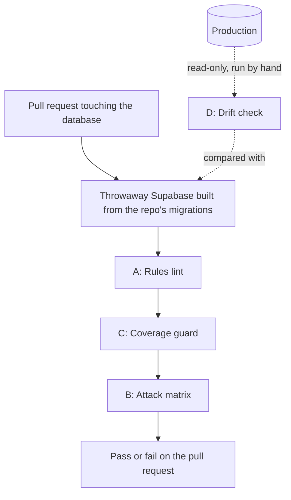

# Security test suite design

Status: decisions made 2026-11-04. Phase 0 is done. A first cut of phase 3 is built (2026-11-12): `.github/workflows/security.yml` runs `npm run test:security` on pull requests touching database paths and on pushes to `main`. That builds a throwaway database from the migrations and runs the existing `test-accounts:rls` checks (75), with no secrets. Phases 1 and 2 are built (2026-11-12): the rules lint (`scripts/security/lint.js`), the attack matrix (`supabase/security/`, 89 rows) and the coverage guard, all run by `test:security` and so by CI. Not yet covered: the avatar storage bucket, because CI starts Supabase without the storage service. Run time locally: about 40 seconds once Docker images are cached. On GitHub about 2½ minutes from cold. Since 2026-11-12 the `rls` check is required on `main` (ruleset `main-protection`).

## Summary

We want an automated security test suite that runs on pull requests touching the database and fails the build when any user could read or change data they shouldn't. It targets the class of bug we fixed in `friend_requests`: the rules let any signed-in user insert a request that was already marked accepted, or rewrite who a request came from. Either way they could make themselves someone's friend and see that person's cycle data without consent.

The suite has four layers:

- A **rules lint** catches risky patterns in the database rules without running any attacks.
- An **attack matrix** signs in as test personas and tries every read and write on every table, function and storage bucket, checking each outcome against what we expect.
- A **coverage guard** fails the build if a new table or function ships without matrix entries.
- A **drift check** confirms production's rules match what the repo says they are.

In CI it runs against a throwaway local copy of Supabase built from the repo's migrations, so it needs no secrets and never touches staging or production.

**Decisions** (detail in the last section):

1. Tests are written in Jest with supabase-js.
2. CI runs on pull requests that touch database paths and on pushes to main. It doesn't run nightly.
3. The production drift check is a manual, read-only script for now.
4. Making the check required needs Krati, as repo owner, once it's stable.
5. Reactions and boops are visible only from yourself and your friends.

## Why the bug happened, and why app tests can't catch it

### The threat model

The app ships with Supabase's public (anon) key inside it. That key is not a secret; anyone can pull it out of the app bundle. Combined with an ordinary account they sign up for themselves, it lets a person call the database API directly with curl or a script, skipping the app entirely. **The database rules (row-level security, column grants and function permissions) are the only thing standing between that person and other users' data.** Whatever the app's screens allow or forbid is irrelevant to them.

So the question for every table and function is: *what can a signed-in stranger do here if they send any request they like?*

### What went wrong in friend_requests

| Hole | How it worked | Result |
|---|---|---|
| Insert pre-accepted | The insert rule only checked that you were the sender. It didn't check the status, so you could insert a request with `status = 'accepted'` straight away. | Instant friendship with anyone whose id you know, with no action from them. |
| Rewrite the sender | The recipient's update rule had no WITH CHECK, and recipients could update every column. A recipient could change `from_user_id` to any third person and accept. | A friendship between the recipient and someone who never asked. |

Both were rule-level mistakes that the app would never trigger, because the app always inserts `pending` and only ever updates `status`.

### Why our existing tests missed it

- **Unit tests** (Jest in `packages/`) test our TypeScript, not the database rules.
- **App walkthroughs** (simulator, personas) only exercise what the UI sends, which is always well-formed.
- **Nobody had tried acting as user B against user A's rows.** That is how we found it: during the friend-flow test, one persona sent raw API requests targeting another. `scripts/test-accounts/rlsChecks.ts` captured those checks: 3 of the first 12 failed before the fix, and all pass after.

The suite generalises that one-off script: every table, every operation, every kind of relationship between two users.

## Design overview: four layers

Each layer catches something the others can't, and they get more expensive to run from top to bottom.



A, B and C run in CI against a throwaway database built only from the repo's migrations. D is the only layer that looks at production, and it only reads.

| Layer | Question it answers | Catches | Cost |
|---|---|---|---|
| A · Rules lint | Do the rules follow our safe patterns? | Ownership or consent columns that a role can rewrite, a table with RLS off, functions callable with no login | Seconds; plain SQL queries against the catalog |
| B · Attack matrix | Can user X actually do Y to user Z's data? | Logic mistakes the lint can't see, like an INSERT rule that forgets to check `status` | About a minute; real API calls as personas |
| C · Coverage guard | Did anyone add something the matrix doesn't test? | A new table, function or bucket shipped with no attack rows | Seconds |
| D · Drift check | Is production what the repo says it is? | Rules changed by hand in the dashboard, or a migration never applied | Seconds; read-only queries |

The forged-friendship bug would have been caught twice. A's ownership-column rule flags that recipients could update `from_user_id`, and B's "stranger inserts an accepted request" row fails.

## Layer details

### A · Rules lint

A set of read-only SQL queries against the database catalog, each one a rule. A rule fails with the table or function name and a one-line fix hint.

1. **RLS is on for every public table.** All 14 tables pass today.
2. **No-login function access is opt-in.** Any public function that `anon` can execute must be listed in an allowlist with a reason. The real fix is a default-privileges change so new functions start closed.
3. **Signed-in functions that ignore who's calling are reviewed.** A function `authenticated` can execute whose body never uses `auth.uid()` needs an allowlist entry.
4. **Ownership and consent columns can't be rewritten.** The rule fails when a role can update every column of a table holding ownership or consent columns (such as `from_user_id`, `to_user_id`, `status`), unless the policy pins each such column or a column grant excludes it. Where WITH CHECK is absent, the rule treats USING as the check, because Postgres reuses USING for updates. This replaces a cruder rule ("fail on any missing WITH CHECK") that would have flagged nine harmless owner-only policies.
5. **SECURITY DEFINER functions set `search_path`.** Without it, a caller can hijack the names the function looks up.
6. **Policies on role `public` mention `auth.uid()` or `auth.role()`.** A policy that doesn't is either intentionally open or a mistake, and goes in the allowlist if intended.

The allowlist lives in the repo, for example `supabase/security/allowlist.json`. Each entry has a reason, so loosening access shows up as a visible line in the pull request diff.

### B · Attack matrix

One file per table or function. Each row says who acts, what they try, and what must happen:

```ts
// supabase/security/matrix/friend_requests.ts
export default [
  { as: 'stranger', op: 'insert', row: { from: 'self', to: 'victim', status: 'accepted' }, expect: 'denied' },
  { as: 'stranger', op: 'insert', row: { from: 'self', to: 'victim', status: 'pending' },  expect: 'allowed' },
  { as: 'pending',  op: 'update', set: { from_user_id: 'third' },                          expect: 'denied' },
  { as: 'pending',  op: 'update', set: { status: 'accepted' },                             expect: 'allowed' },
  { as: 'stranger', op: 'select', target: 'victim',                                        expect: 'hidden' },
  { as: 'anon',     op: 'select', target: 'victim',                                        expect: 'hidden' },
];
```

**Actors** are personas with fixed relationships, set up by the seed step:

- `owner`: acting on their own rows
- `friend`: an accepted request in place
- `pending`: a request outstanding
- `stranger`: no relationship
- `anon`: not signed in

**Outcomes:**

- `allowed`: the operation succeeds.
- `denied`: an error comes back.
- `hidden`: zero rows come back, or nothing changes.

For `hidden`, the runner reads the row back with the service key, because a blocked UPDATE in Supabase reports success with zero rows changed. Only the read-back proves nothing happened.

Each row becomes one Jest test that signs in as the persona through supabase-js and makes the real API call. It's the same thing an attacker would do. `scripts/test-accounts/rlsChecks.ts` becomes the first matrix file.

| Target | Example row | Expect |
|---|---|---|
| cycle_snapshots | stranger reads Ava's snapshot | hidden |
| cycle_snapshots | owner updates own row, setting user_id to Bea | denied |
| friend_cycle_summaries() | friend calls it | sees Ava's phase |
| friend_cycle_summaries() | stranger calls it | Ava not in result |
| search_users() | anon calls it | denied |
| search_users() | stranger searches '%' | no rows |
| mark_phase_reminded() | any signed-in user, any target | denied |
| profile-avatars bucket | stranger overwrites Ava's avatar | denied |

### C · Coverage guard

The guard reads the catalog for every public table, every public function and every storage bucket. Each one must have matrix rows for every operation some role is granted, or an explicit `notApplicable` entry with a reason. Trigger functions are excluded automatically. A pull request that adds a table without attack rows fails here, before anyone has to remember.

## CI design

### What the job does

A new GitHub Actions workflow, `.github/workflows/security.yml`, runs on a standard Linux runner:

1. Check out the repo and install Node dependencies.
2. Install the Supabase CLI and run `supabase start`. This boots a complete local Supabase (database, auth, API, storage) in Docker on the runner.
3. Run `supabase db reset`, which builds the database from nothing using only the repo's migrations.
4. Seed the personas and their relationships using the local stack's service key. That key is a fixed demo value printed by the CLI, not a secret.
5. Run `npm run test:security`, which runs the lint, the coverage guard and the attack matrix, in that order.

A failure names the exact row, for example: *stranger · insert · friend_requests (status=accepted): expected denied, got allowed*.

### No secrets, no shared databases

The job never connects to staging or production, and needs no GitHub secrets. That keeps it safe on a public repo: a pull request from anyone can run it without exposing anything, and a broken test can't damage real data. It also proves the migrations build a working database from scratch, which nothing checks today.

### When it runs

- **Pull requests** that touch `supabase/**`, `scripts/test-accounts/**`, the security tests themselves, or the workflow file.
- **Pushes to main**, with the same path filter, so main always has a known result.
- **No nightly run.**

If the check later becomes required, the job must always report a result and skip the work when no database files changed. Otherwise a required check with a path filter leaves unrelated pull requests waiting forever.

### Running it yourself

The same `npm run test:security` works on a Mac with Docker Desktop. A `--target staging` option runs the matrix against staging using `.env.staging`. Staging matches production, so this is the best pre-production check; it's for manual runs only, never CI.

### Cost and speed

GitHub Actions minutes are free for public repos. The run time is unmeasured. Expect a few minutes, mostly spent pulling Supabase's Docker images, and phase 3 will measure it and cache images if needed.

### Making it required

A red check only blocks merging if branch protection on `main` lists it as a required check. That's a repo setting only the owner (Krati) can change. Until then it's advisory: visible on every pull request, but mergeable.

## Prerequisites and risks

### The migrations must build production from scratch

CI tests whatever the migrations produce. If that isn't production, the suite passes against the wrong database. Three gaps stand in the way today:

1. **Hand-made production changes aren't in migrations.** These are the `cycle_guidance_requests` table, the `phase_started_at` column, the `claim_cycle_guidance` and `complete_cycle_guidance` functions, and a cron job difference. Staging got them from a one-off catch-up script, not from migrations. A *drift-capture migration* has to add them to the repo first.
2. **About eight near-duplicate migration pairs.** Staging was built from a hand-assembled file of all migrations, which applied cleanly. `supabase db reset` runs them one by one in timestamp order, though, so a clean run needs confirming and any pair that conflicts needs fixing.
3. **The seed-posts migration** inserts demo content. CI should skip it or move it into seed data, as staging did.

The staging work gives a reliable target to check against: staging's column and policy fingerprints already equal production's. Once the local build produces the same fingerprints, we know CI is testing the real thing.

### Risks

| Risk | Mitigation |
|---|---|
| **The repo is public**, so an attack row for an unfixed hole tells anyone how to exploit it. | Fix production first, then commit the row. Track open findings privately. |
| **Closing default function access changes behaviour.** Revoking `anon` and `authenticated` by default means a new function the app needs must be granted explicitly. | The coverage guard makes the miss obvious, and the error is immediate in local testing. |
| **Edge functions aren't covered.** They run with the service key and bypass RLS, so their own checks matter. | Phase 4 adds tests that call each edge function as anon, stranger and owner. |
| **A matrix only tests what it lists.** | The coverage guard forces a row per operation per object, and rows are reviewed like code. |
| **Docker image pulls can be flaky in CI.** | Retry once, and cache images if it becomes a problem. |

## Plan and decisions

### Phases

Each phase is its own pull request, and each one is useful on its own.

| Phase | Deliverable | Done when |
|---|---|---|
| **0 · Close what we know** | Function-grant fix, `search_users` wildcard and limit fix, and friends-only reactions and boops (all done on staging and production). Still to do: drift-capture migration, and marking existing migrations as applied so `supabase db push` can be used. | `supabase db reset` builds clean locally, and its fingerprints match production's. |
| **1 · Local suite, friend tables** | `npm run test:security` with the rules lint and allowlist, plus matrix files for friend_requests, friend_sharing, posts, reactions, boops and the cycle-sharing functions. Absorbs `rlsChecks.ts`. | Green locally and against staging. Would have caught both friend_requests holes. |
| **2 · Full coverage** | Matrix rows for all 14 tables, every callable function and the avatar bucket. Coverage guard switched on. | Guard passes with no unexplained gaps. |
| **3 · CI** | The GitHub Actions workflow on database-path pull requests and pushes to main, always reporting a result. | Green on main, with run time measured. Then Krati makes it required. |
| **4 · Drift and habits** | Manual drift-check script (D). Edge function tests. An AGENTS.md rule that any migration adding a table or function must add matrix rows. A pull request checklist line. Later, as its own project: deploy migrations automatically. | First drift report reviewed. Rule merged. |

Phases 1 and 2 are where most of the protection comes from.

### Decisions (made 2026-11-04)

**1. Test language: Jest + supabase-js.** The tests sign in as real personas and call the same HTTP API an attacker would, including auth and storage. They reuse the personas and the existing Jest setup. The lint queries are plain SQL, run from Jest. We chose this over pgTAP, which tests by switching database roles inside SQL instead of going through the API.

**2. CI triggers: pull requests that touch database paths, plus pushes to main. No nightly run.** The pull request run catches problems before they merge. The run on main checks what actually landed, for three cases:

- two PRs that pass alone but break together
- a merge made before its check finished
- a direct push

Both runs use the same path filter. A Supabase platform change will surface on the next database PR rather than overnight.

**3. Production drift check: a manual, read-only script.** CI tests the database the migrations build, so it only protects production if the two match. They have drifted before, through hand-made dashboard changes and fixes pasted into the SQL editor. The check is one read-only query pasted into the production SQL editor after any change made outside a migration, and every so often. Its output is compared with the repo's build. No production credential goes into GitHub.

Dashboard edits can't be locked out on the current Supabase plan. To make them rare:

- Apply migrations with `supabase db push` once the existing migrations are marked as applied, a phase 0 task.
- Later, a separate project could deploy them automatically on merge.

**4. Required check: Krati turns it on once the check is stable.** The repo is in Krati's personal GitHub account, where only the owner has admin and collaborators can't be given it. Shaan's write access covers everything else: adding the tests and the CI job, which report on every PR without blocking. After about a week green on main, Krati marks it as required for `main`. The job always reports a result and skips the work when no database files changed, so unrelated PRs don't wait forever. Moving the repo into a GitHub organization would let both of them administer it, which is optional.

**5. Reactions and boops: friends only.** A viewer sees a post reaction or boop only if one of these is true:

- they made it
- they received it
- they wrote the post
- they're friends with the person who made it

Counts on a post can differ between viewers, and that's accepted. Posts themselves were already friends-only.
